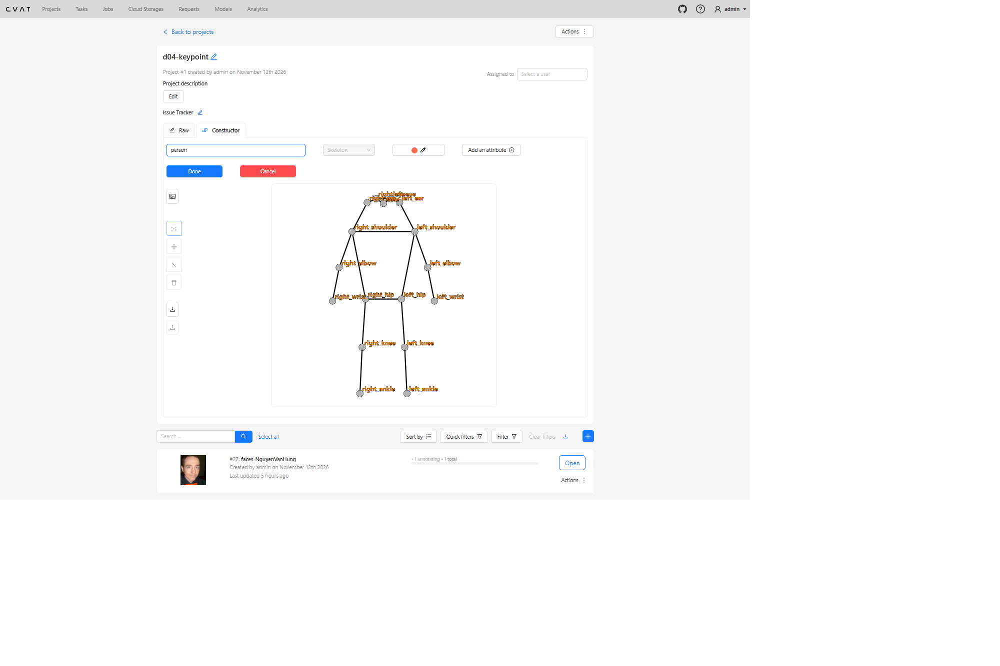
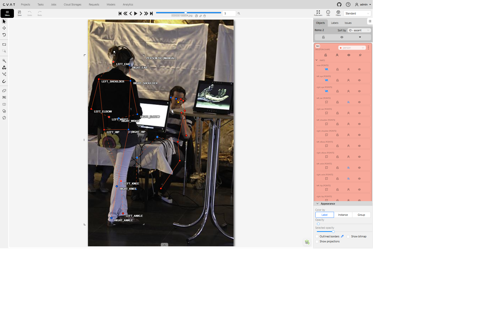
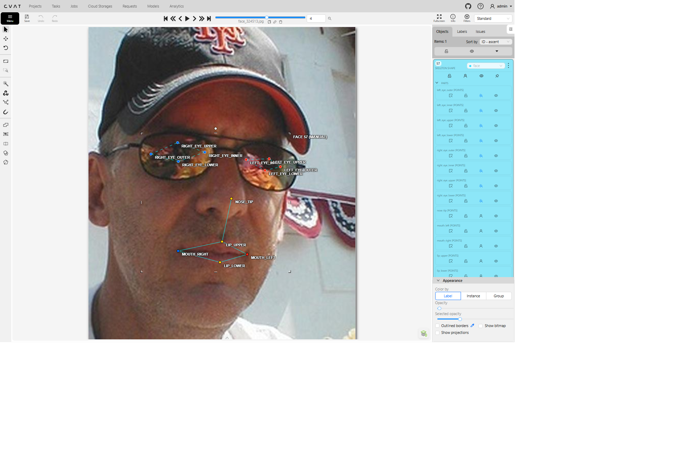
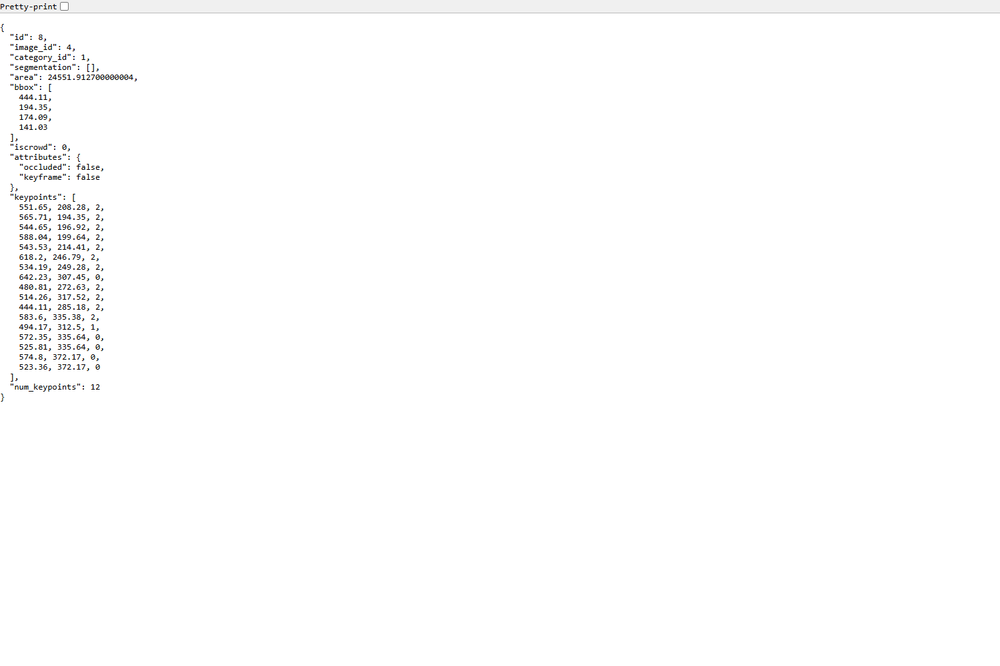

# Báo cáo cá nhân — Nguyễn Văn Hùng-202603097

Dữ liệu: 12 ảnh người COCO 2017 (Lin et al., 2014) và 8 ảnh khuôn mặt cắt từ COCO 2017, chỉ dùng trong lớp.

## 0. Thông tin học viên

- Họ tên: Nguyễn Văn Hùng
- MSSV: 202603097
- Email: hunghocweb2709@gmail.com
- Link repository: https://github.com/hunghocweb/K5-L2-DAY04-NguyenVanHung-2A202603097-KeypointPose
- Phiên bản CVAT (Help → About): 2.74.1
- Máy: hệ điều hành Windows · RAM 16 GB · chạy CVAT chế độ đầy đủ
- Bộ ảnh (`src/exports/assignment.json` do `lab.py setup` tạo): có
- Giờ bắt đầu: 16:00
- Giờ kết thúc: 19:30
- Tổng khoảng thời gian từ bắt đầu đến kết thúc: 3 giờ 30 phút = 210 phút.

## 1. Kiểm tra label (CP0)

| Label | Kiểu | Số điểm | Tên điểm đúng bảng của lab? | Đúng thứ tự? | Số cạnh |
|---|---|---:|---|---|---:|
| `person` | Skeleton | 17 | Đúng | Đúng | 19 |
| `face` | Skeleton | 13 | Đúng | Đúng | 13 |

Mẫu `person` dựng theo người quay mặt về camera (các điểm `left_*` nằm bên phải khung mẫu)? Có

Cách đổi cờ `occluded` / `outside` cho **một điểm** trên phiên bản CVAT này (một câu):

Rê chuột đúng điểm, bấm Q để bật/tắt occluded hoặc O để bật/tắt outside

## 2. Số lượng đã gán và thời gian (CP1, CP2)

| Nhóm ảnh | Số ảnh | Số skeleton đã gán | Số người dưới 60 px (không gán) | Số poster / gương / màn hình bỏ qua | Thời gian (phút) |
|---|---:|---:|---:|---:|---:|
| `easy` | 5 | 5 | 1 | 1 | 25 (ước tính) |
| `occluded` | 3 | 6 | 0 | 0 | 30 (ước tính) |
| `back` | 2 | 4 | Khoảng 12 | 0 | 20 (ước tính) |
| `small` | 1 | 3 | 0 | 0 | 10 (ước tính) |
| `crowd` | 1 | 3 | 0 | 0 | 20 (ước tính) |
| `faces` | 8 | 8 | — | 0 | 35 (ước tính) |

Người dưới 60 px: một người ở xa trên sườn tuyết trong `000000365099.jpg`; khoảng 12 người ở xa trong `000000307757.jpg`. Ảnh in bỏ qua: một khung ảnh có hai người trên tường trong `000000201702.jpg`; đếm theo khung ảnh.

Thời gian từng nhóm và tiến độ dưới đây là ước tính trong khung 16:00–19:30.

| Khoảng giờ | Công việc | Thời lượng ước tính (phút) |
|---|---|---:|
| 16:00–16:10 | CP0: đọc quy tắc, kiểm tra hai label và cách đặt cờ | 10 |
| 16:10–16:35 | CP1: 5 ảnh `easy` | 25 |
| 16:35–17:05 | CP1: 3 ảnh `occluded` | 30 |
| 17:05–17:25 | CP1: 2 ảnh `back` | 20 |
| 17:25–17:35 | CP1: 1 ảnh `small` | 10 |
| 17:35–17:55 | CP1: 1 ảnh `crowd` | 20 |
| 17:55–18:30 | CP2: 8 ảnh khuôn mặt | 35 |
| 18:30–19:05 | CP3: tự review, đối chiếu ảnh và ghi lỗi | 35 |
| 19:05–19:30 | CP4: xuất file, chạy kiểm tra và hoàn thiện báo cáo | 25 |
| **Tổng** | | **210** |

- Mốc phút 105 tính từ 16:00 là **17:45**.
- Số ảnh người đã xong ở mốc phút 105: **ước tính 10 / 10** ảnh thuộc ba nhóm `easy`, `occluded`, `back`.
- Thời lượng ước tính: **CP1 105 phút · CP2 35 phút · CP3 35 phút**; cộng CP0 10 phút và CP4 25 phút thành 210 phút.
- Ảnh tốn thời gian nhất là ảnh nào, vì sao?

Ảnh **`000000522889.jpg`** có thời gian xử lý ước tính **20 phút**. Ảnh có ba người cần kiểm riêng. Người đánh tennis ở tiền cảnh cầm vợt bằng hai tay nên hai cánh tay và cổ tay nằm sát nhau; cần lần theo vai–khuỷu–cổ tay để tránh đổi trái/phải. Một chân co ra sau, chân còn lại duỗi xuống sân nên phải kiểm theo hông–gối–cổ chân. Hai người ở hậu cảnh nhỏ hơn và có vùng chồng lấp, cần phóng to để tách từng skeleton và đặt cờ theo phần nhìn thấy.

## 3. Bảng ca khó (CP1, CP2)

Mỗi điểm bạn phân vân một dòng, nhất là phân vân giữa `v = 1` và `v = 0`, hoặc không chắc hướng người.

| Ảnh | Người / mặt | Điểm | Cờ đã chọn | Phân vân giữa | Lý do chọn |
|---|---|---|---|---|---|
| `000000179201.jpg` | Người bên phải, đội mũ | `left_elbow` | `v = 0` sau sửa | `v = 2` / `v = 0` | Vì khuỷu tay trái nằm ngoài khung ảnh. |
| `000000188804.jpg` | Người đứng quay lưng | `left_wrist`, `right_wrist` | `v = 1` | `v = 1` / `v = 0` | Hai cổ tay khuất, vị trí ước lượng theo hướng cẳng tay còn thấy. |
| `000000150192.jpg` | Người phía sau chỉ lộ đầu | Các điểm thân | `v = 0` | `v = 1` / `v = 0` | Không thấy đủ thân để xác định khớp; giữ outside. Cần quyết định riêng có thuộc đối tượng cao từ 60 px cần gán hay không. |
| `face_223746.jpg` | Mặt nghiêng | `right_eye_inner` | `v = 1` | `v = 1` / `v = 0` | Khóe mắt xa gần sống mũi; cờ hiện tại hợp lý nếu xác định được chắc vị trí. Cần xem cùng vị trí mí khi phóng to. |
| `face_324513.jpg` | Mặt kính râm | 8 điểm của hai mắt | `v = 1` | `v = 1` / `v = 0` | Tròng kính tối che mắt; cả 8 điểm đang occluded, phù hợp quy tắc lab khi ước lượng được từ gọng kính. |
| `face_483667.jpg` | Mặt tóc che | `left_eye_outer`, `left_eye_upper` | `v = 1` | `v = 1` / `v = 0` | Tóc đi qua vùng mắt trái; cần kiểm độ chắc chắn từng điểm, không đổi đồng loạt mọi điểm của mắt. |

## 4. Bảng tự review (CP3)

Đi từ ảnh cuối về ảnh đầu. 5 ảnh người (ít nhất 2 ảnh `back` hoặc `crowd`) và 3 ảnh mặt. Ít nhất 8 dòng, kể cả dòng `ok`. Ghi lỗi trước, sửa sau.

Mã lỗi dùng đúng một trong: `lr_swap`, `vis_flag`, `position`, `missing`, `extra`, `ok`.

| Ảnh | Người / mặt | Điểm | Mã lỗi | Ghi chú | Đã sửa? |
|---|---|---|---|---|---|
| `000000522889.jpg` | Vận động viên tiền cảnh | Cổ tay, gối, cổ chân | `ok` | Tư thế đánh bóng hai tay và một chân co tạo đổi phía trên ảnh; chưa thấy căn cứ đổi tên chỉ theo cảnh báo dấu x. Giữ nhãn theo tư thế đánh bóng thực tế. | Không đổi |
| `000000467300.jpg` | Hai người ở bàn bánh | Các điểm thân dưới | `ok` | Thân dưới khuất sau bàn đã outside; không có skeleton trên bánh hay đồ trang trí. | Không cần trong phạm vi này |
| `000000365099.jpg` | Người trượt tuyết | Hai mắt | `vis_flag` | Vì hai mắt bị kính tối che, em đổi sang `v = 1`. | Đã sửa cả hai mắt thành `occluded`; đã xuất lại nhãn. |
| `000000307757.jpg` | Hai người quay lưng | Vai và hông trái/phải | `ok` | Điểm trái ở phía trái ảnh, mặt không nhìn thấy đã outside. | Không cần trong phạm vi này |
| `000000213933.jpg` | Người chơi tennis | Toàn skeleton | `ok` | Có một skeleton; người quay mặt, các cặp vai/hông đúng hướng tổng thể. | Không cần trong phạm vi này |
| `000000201702.jpg` | Người trong bếp | Phạm vi đối tượng | `ok` | Một người thật được gán, ảnh chân dung treo tường không có skeleton. | Không cần trong phạm vi này |
| `000000188804.jpg` | Người đứng quay lưng | Hai chân | `lr_swap` | Nghi vấn cần xác minh: đường hông–gối đổi phía. Có thể là đứng chéo chân thật; cần lần theo từng ống quần trước khi kết luận lỗi. | Chưa; chưa đổi tên |
| `000000184224.jpg` | Người cầm ô | Phạm vi đối tượng | `ok` | Một skeleton người; không gán chó hoặc phần phản chiếu bên dưới. | Không cần trong phạm vi này |
| `000000179201.jpg` | Người đội mũ bên phải | `left_elbow` | `vis_flag` | Điểm (642,23; 307,45) nằm ngoài ảnh rộng 640 px nhưng trước sửa v = 2. Đã bật outside qua hàm cập nhật CVAT, xuất lại thành v = 0. | Có; kiểm chứng tọa độ không đổi |
| `000000163118.jpg` | Người áo cam | Hai cổ chân | `ok` | Động tác bật nhảy làm hai chân chồng nhau; cảnh báo đổi phía không đủ để kết luận lr_swap. | Giữ tên theo đường đi của chân khi bật nhảy. |
| `000000150192.jpg` | Người nền chỉ lộ đầu | Skeleton có điểm trải cao 17 px | `extra` | Nghi vấn cần xác minh ngưỡng 60 px; chỉ 7 điểm đầu/vai có v > 0. Không dùng riêng chiều cao các điểm để kết luận người cao 17 px. | Chưa; chưa xóa |
| `000000019754.jpg` | Người trên ván | Hai mắt | `vis_flag` | Kính tối che vùng mắt nhưng hai điểm mắt đang v = 2; cần xác nhận rồi chọn cờ phù hợp. Cổ tay đổi phía có thể do hai tay đặt khác hướng. | Chưa sửa: cần phân biệt mắt nhìn thấy với mắt bị kính che. |
| `face_504911.jpg` | Mặt kính trong | `nose_tip` | `position` | Điểm đang lệch về cạnh trái ảnh của vùng mũi so với chóp mũi thấy rõ; cần đặt lại bằng tay. 8 điểm mắt đang v = 2 phù hợp kính trong. | Chưa; cần kéo điểm trên CVAT |
| `face_483667.jpg` | Mặt tóc che | Cờ mắt trái | `ok` | Hai điểm ở vùng tóc che đang v = 1; các điểm khác không bị đổi cờ đồng loạt. | Giữ v = 1 cho hai điểm ở vùng tóc che. |
| `face_421231.jpg` | Mặt thẳng | Trái/phải hai mắt | `ok` | left_eye nằm bên phải ảnh, khóe ngoài xa sống mũi hơn khóe trong. | Không cần trong phạm vi này |
| `face_324513.jpg` | Mặt kính râm | `nose_tip` | `position` | Điểm (278,40; 334,93) còn ở cao trên thân/cạnh mũi, chưa trùng chóp mũi; cần kéo xuống đúng chóp khi phóng to. | Chưa; cần kéo điểm trên CVAT |
| `face_232598.jpg` | Mặt đội mũ | Khóe mắt và mí | `position` | Một số đỉnh đường mắt chưa bám sát khóe/mép mí; cần kiểm lại từng điểm ở mức pixel, nhất là mắt bên trái ảnh. | Chưa; cần chỉnh tay |
| `face_223746.jpg` | Mặt nghiêng | Mí mắt gần camera | `position` | Điểm mí trên còn cao gần vùng lông mày; cần bám mép mí, không giữ hình thoi của mẫu. | Chưa; cần chỉnh tay |
| `face_185015.jpg` | Mặt nghiêng, mắt híp | `nose_tip` | `position` | Điểm mũi lệch lên và sang trái ảnh so với chóp mũi thấy rõ. | Chưa; cần chỉnh tay |
| `face_122747.jpg` | Mặt thẳng | Trái/phải, khóe trong/ngoài | `ok` | Hướng hai mắt và hai khóe miệng phù hợp quy ước; độ sát mép mí cần rà lại khi phóng to. | Không cần trong phạm vi này |

Tổng hợp số lỗi theo mã:

| `lr_swap` | `vis_flag` | `position` | `missing` | `extra` | `ok` |
|---:|---:|---:|---:|---:|---:|
| 1 nghi vấn | 3 | 5 | 0 được ghi nhận | 1 nghi vấn | 10 |

Điểm còn phân vân giữa `v = 1` và `v = 0` (ghi cả hai lựa chọn và lý do chọn):

Hai cổ tay của người quay lưng trong 000000188804.jpg đang v = 1; cần xác nhận mức độ chắc chắn của vị trí ước lượng, nếu không xác định được thì chọn v = 0.

## 5. Kiểm file xuất và kết quả tự kiểm (CP4)

Tự kiểm tay trong file JSON:

| File | Người / mặt kiểm (ảnh, thứ tự) | Số phần tử `keypoints` | Điểm `outside` ra `v = 0`, `occluded` ra `v = 1`? | `num_keypoints` khớp? |
|---|---|---:|---|---|
| `NguyenVanHung_persons.zip` | `000000179201.jpg`, người thứ 2, đội mũ bên phải | 51 | Đúng | Khớp, 12 điểm |
| `NguyenVanHung_persons.zip` | `000000188804.jpg`, người thứ 1, đứng quay lưng | 51 | Đúng | Khớp, 14 điểm |
| `NguyenVanHung_faces.zip` | `face_324513.jpg`, mặt thứ 1 | 39 | Đúng với các điểm bị che; không có điểm outside | Khớp, 13 điểm |

Sau khi xuất, CVAT ghi `occluded` thành `v = 1` và `outside` thành `v = 0`. Tọa độ của điểm `outside` trong file là `0, 0` hay tọa độ cũ? Tọa độ cũ.

Trạng thái hoàn thành: hai job bonus B1/B2 đã **completed**. Hai job chính chưa được xác nhận **completed** trong lần chuẩn bị hồ sơ này; trạng thái CVAT không được lưu trong ZIP xuất dataset.

Dán phần **TÓM TẮT** in ra từ `src/check_submission.py`:

```text
----- TÓM TẮT (dán vào báo cáo mục 5) -----
- File person: NguyenVanHung_persons.zip
  Số ảnh: 12 · số skeleton `person`: 21 · mỗi annotation 51 số
  Skeleton theo ảnh: 000000019754=1, 000000150192=3, 000000163118=2, 000000179201=2, 000000184224=1, 000000188804=2, 000000201702=1, 000000213933=1, 000000307757=2, 000000365099=1, 000000467300=2, 000000522889=3
  Cờ v: v=2 245 (69%) · v=1 38 (11%) · v=0 74 (21%)
  num_keypoints trung bình: 13.5
- File face: NguyenVanHung_faces.zip
  Số ảnh: 8 · số skeleton `face`: 8 · mỗi annotation 39 số
  Skeleton theo ảnh: face_122747=1, face_185015=1, face_223746=1, face_232598=1, face_324513=1, face_421231=1, face_483667=1, face_504911=1
  Cờ v: v=2 93 (89%) · v=1 11 (11%) · v=0 0 (0%)
  num_keypoints trung bình: 13.0
- Ghi chú: 74 điểm v = 0 vẫn mang tọa độ cũ (CVAT 2.x xuất như vậy; chuẩn COCO ghi 0, 0). Không phải lỗi: điểm v = 0 bị bỏ qua khi huấn luyện và khi chấm.
- Số [LỖI]: 0 · số [CẢNH BÁO]: 5
Kết quả: ĐẠT (đọc lại từng cảnh báo ở trên)
```

Các `[CẢNH BÁO]` còn giữ nguyên và lý do:

- `000000019754.jpg`: cổ tay ngược phía; tư thế hai tay có thể gây đổi phía thật, cần kiểm lại.
- `000000150192.jpg`: skeleton chỉ trải cao 17 px; chưa xác nhận đối tượng có đạt ngưỡng 60 px.
- `000000163118.jpg`: cổ chân ngược phía khi bật nhảy, cần xác nhận theo từng chân.
- `000000188804.jpg`: cổ chân ngược phía; còn nghi vấn chéo chân thật hoặc nhầm tên.
- `000000522889.jpg`: cổ tay, gối, cổ chân ngược phía do tư thế đánh bóng và chân co; cần kiểm lần cuối.

## 6. Ảnh chụp màn hình

1. Label `person` trong label constructor (đủ 17 điểm có tên):

   

2. Một người quay lưng đã gán, cờ đã đặt — ảnh `000000188804.jpg`, job 26:

   

3. Một khuôn mặt đã gán 13 điểm, phóng to vùng mắt — ảnh `face_324513.jpg`, job 27:

   

4. Một đoạn JSON xuất của một người — annotation `id: 8` trong `NguyenVanHung_persons.zip`:

   

Nguồn ảnh: COCO 2017.

## 7. Tự đánh giá

1. Lỗi bạn mắc nhiều nhất hôm nay, và cách bạn sẽ tránh ở dự án thật:

   Qua rà soát, lỗi vị trí điểm mặt xuất hiện nhiều nhất trong bảng review, nhất là chóp mũi và mép mí. Cách tránh: phóng to, chỉnh từng điểm theo mép thật và rà lại sau khi đặt mẫu.

2. Một quy tắc bạn đề xuất thêm vào guideline (kèm ảnh ví dụ nếu có):

   Bổ sung bước kiểm riêng chóp mũi và mép mí sau khi gán mặt; không giữ hình thoi của mẫu nếu chưa khớp ảnh. Ví dụ: face_324513.jpg và face_223746.jpg.

3. Nhãn của bạn đi vào model ở đâu? Chọn một lỗi bạn đã sửa và nói nó sẽ làm model học sai thế nào (heatmap, trọng số trong loss, hay bước lật ảnh):

   Điểm có v > 0 tạo mục tiêu vị trí/heatmap và được tính loss. Lỗi đã sửa: left_elbow ở x = 642,23 trên ảnh rộng 640 px vẫn có v = 2. Đổi sang outside, v = 0, giúp loại bỏ giám sát sai ngoài ảnh. Sai tên trái/phải còn tạo mâu thuẫn khi lật ảnh huấn luyện.

## 8. Khó khăn và lỗi kỹ thuật

Lần kiểm đầu có 1 lỗi và 5 cảnh báo. Đã sửa cờ outside của khuỷu tay ngoài ảnh trên CVAT, xuất lại và kiểm: 0 lỗi, 5 cảnh báo. Đã bổ sung 4 ảnh chụp màn hình vào mục 6.

## Bonus

Đã thực hiện B1 và B2. Hai job bonus đã chuyển sang **completed**. File xuất định dạng **COCO Keypoints 1.0**, không kèm ảnh gốc.

### B1 — 3 ảnh người khó thêm

- File nộp: [`NguyenVanHung_bonus_persons.zip`](../../src/exports/NguyenVanHung_bonus_persons.zip).
- Tổng: **3 ảnh, 8 skeleton `person`**, mỗi skeleton đủ 17 điểm (51 số trong `keypoints`).

| Ảnh | Số skeleton | Số người dưới 60 px | Ca khó nhất |
|---|---:|---:|---|
| `000000188948.jpg` | 3 | 0 | Cánh tay có tàn ảnh nên khó xác định đặt điểm theo phía nào; em chọn phía đậm hơn. |
| `000000254060.jpg` | 2 | 0 | Hai người ngồi trên cùng xe máy, người phía sau bị người phía trước che một phần. |
| `000000517702.jpg` | 3 | 0 | Ô che vùng đầu và thân trên; người ở phía trên ảnh chỉ còn thấy phần thân dưới. |

Không ghi nhận người dưới 60 px trong ba ảnh bonus. Theo trải nghiệm khi gán, ảnh đầu `000000188948.jpg` là ca khó nhất vì cánh tay có tàn ảnh; lựa chọn đã dùng là bám theo phần ảnh đậm hơn.

### B2 — 5 ảnh khuôn mặt đen trắng / hồng ngoại

- File nộp: [`NguyenVanHung_bonus_faces.zip`](../../src/exports/NguyenVanHung_bonus_faces.zip).
- Tổng: **5 ảnh, 5 skeleton `face`**, mỗi skeleton đủ 13 điểm (39 số trong `keypoints`).

| Ảnh | Số skeleton | `v = 2` | `v = 1` | `v = 0` |
|---|---:|---:|---:|---:|
| `face_274219.jpg` | 1 | 11 | 2 | 0 |
| `face_300200.jpg` | 1 | 9 | 4 | 0 |
| `face_379585.jpg` | 1 | 13 | 0 | 0 |
| `face_494518.jpg` | 1 | 13 | 0 | 0 |
| `face_507166.jpg` | 1 | 13 | 0 | 0 |

Ảnh không màu khó hơn ở điểm nào? Kính râm trên ảnh hồng ngoại có còn là `v = 1` không?

Ảnh đen trắng không có thông tin màu để tách da, tóc, râu và vùng bóng; vì vậy cần dựa vào độ sáng, đường biên và hình dạng để xác định khóe mắt, mép mí, chóp mũi và viền môi. Ở các ảnh có râu hoặc bóng quanh mắt, đường biên có thể khó phân biệt hơn. Cần phóng to từng vùng thay vì đặt điểm theo khung mẫu.

Với ảnh hồng ngoại, không mặc định mọi điểm mắt sau kính râm đều là `v = 1`. Áp dụng quy tắc visibility trên chính ảnh đang gán: điểm mắt nhìn thấy rõ là `v = 2`; bị kính che nhưng ước lượng chắc vị trí là `v = 1`; bị che và không xác định được vị trí là `v = 0`. Màu tối của kính trong ảnh màu không đủ để quyết định cờ trong ảnh hồng ngoại. Năm ảnh B2 đang nộp là ảnh đen trắng và không có trường hợp đeo kính râm; phần trả lời về hồng ngoại là cách áp dụng quy tắc cho tình huống đó.

### Kết quả kiểm tra B1 và B2

Lệnh chạy từ thư mục gốc của repository:

```bash
python src/check_submission.py --persons src/exports/NguyenVanHung_bonus_persons.zip --faces src/exports/NguyenVanHung_bonus_faces.zip --expected-person-images 3 --expected-face-images 5
```

```text
----- TÓM TẮT (dán vào báo cáo mục 5) -----
- File person: NguyenVanHung_bonus_persons.zip
  Số ảnh: 3 · số skeleton `person`: 8 · mỗi annotation 51 số
  Skeleton theo ảnh: 000000188948=3, 000000254060=2, 000000517702=3
  Cờ v: v=2 79 (58%) · v=1 19 (14%) · v=0 38 (28%)
  num_keypoints trung bình: 12.2
- File face: NguyenVanHung_bonus_faces.zip
  Số ảnh: 5 · số skeleton `face`: 5 · mỗi annotation 39 số
  Skeleton theo ảnh: face_274219=1, face_300200=1, face_379585=1, face_494518=1, face_507166=1
  Cờ v: v=2 59 (91%) · v=1 6 (9%) · v=0 0 (0%)
  num_keypoints trung bình: 13.0
- Ghi chú: 38 điểm v = 0 vẫn mang tọa độ cũ (CVAT 2.x xuất như vậy; chuẩn COCO ghi 0, 0). Không phải lỗi: điểm v = 0 bị bỏ qua khi huấn luyện và khi chấm.
- Số [LỖI]: 0 · số [CẢNH BÁO]: 0
Kết quả: ĐẠT
```

Phần tóm tắt kết quả kiểm tra B1 và B2 được chèn đầy đủ ở trên.

### B3 — Model so với nhãn của tôi (không tính điểm)

Không có kết quả B3 trong bộ file xuất hiện tại. Phần bonus nộp gồm B1 và B2.

## 9. Tài liệu tham khảo và công cụ AI đã dùng

Tài liệu: README.md, CHECKPOINTS.md, SUBMISSION.md, RUBRIC.md, RULES.md, docs/GUIDELINE.md, docs/CVAT_CHEATSHEET.md, docs/COCO_KEYPOINTS.md và src/lab/pool.json. Công cụ AI: Codex hỗ trợ kiểm file xuất, đối chiếu ảnh với nhãn đã lưu, lập nhận xét review, sửa một cờ outside và biên tập báo cáo; các nhận xét dựa trên ảnh gốc và nhãn đã lưu. Phần thời gian được chỉnh theo khung 16:00–19:30 do học viên cung cấp; phân bổ từng nhóm và tiến độ phút 105 là ước tính có giả định, không phải lịch sử thao tác CVAT.
